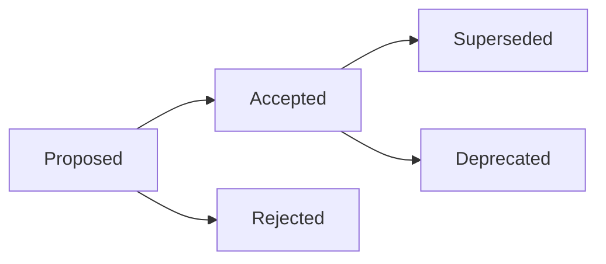

# Decision log

_How to use this template: italic lines are guidance. Replace them with your own words, then delete them. Values in square brackets are yours to fill in. Each decision has its own record, linked from the table below; a record is never deleted, and a decision that changes gets a new record that supersedes it._

## Decisions

```dataviewjs
// Configuration
const includeCurrentFile = false; // Set to true to include the MOC/index note itself
const sortAlphabetically = true; // Set to false to keep default file system order

const currentFile = dv.current().file;
const rootFolder = currentFile.folder; // Gather all markdown files in the current folder and subfolders

let pages = dv.pages(rootFolder ? `"${rootFolder}"` : "")
	.where(p => includeCurrentFile || p.file.path !== currentFile.path);
	
if (sortAlphabetically) {
	pages = pages.sort(p => p.file.path, 'asc');
}

dv.table(
	["ID", "Name", "Status", "Date", "Decided By", "Supersedes"],
	pages.map(p => [
		dv.fileLink(p.file.path, false, p.id),
		p.name,
		p.status,
		p.date,
		p.decided_by,
		p.supersedes
	])
)
```

## Statuses


_How a decision’s status changes_

| Status     | Meaning                                              |
| ---------- | ---------------------------------------------------- |
| Draft      | In the process of being written                      |
| Proposed   | Written and open for review, not decided yet         |
| Accepted   | Decided: the team works to it                        |
| Rejected   | Decided against, and kept so nobody has to ask again |
| Superseded | Replaced by a later decision, whose number it gives  |
| Deprecated | No longer applies, and nothing replaced it           |
| Withdrawn  | No longer looking for a decision                     |

## When to write a record

- The decision is hard to reverse: [a database, a supplier, a public API, a price]
- Several options were seriously considered
- Someone will ask why in six months
- It changes how another team works

## How we decide

**Owner:** [name] · **Status:** draft · **Last reviewed:** [date]

_The rules of the log, agreed once. Without them, records get written for small things and skipped for big ones._

## Who decides

| Kind of decision | Proposed by | Decided by | Consulted |
| --- | --- | --- | --- |
| [Architecture] | [any engineer] | [tech lead] | [...] |
| [Product scope] | [...] | [product owner] | [...] |
| [Supplier or spending] | [...] | [...] | [...] |

## From proposal to decision

1. Copy the [[ADR-XX - Record Template]], give it the next number and the status proposed.
2. Write the context and at least two options before the decision.
3. Ask the deciders to review it by [date].
4. Set the status to accepted or rejected, with the date and the deciders.

## Changing a decision

_Never edit an accepted record to say something else. Write a new record that supersedes it, set the old one to superseded with the new record’s number, and link the two both ways._

## Reviews

- Accepted decisions are reviewed: [every quarter, at each milestone]
- Proposed decisions older than [two weeks] are decided or withdrawn
