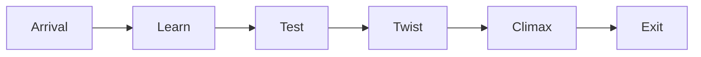

# Flow and beats

**Owner:** [name] · **Status:** draft · **Last reviewed:** [date]

## Flow

_Replace these beats with the level’s own. If the team cannot draw the flow, the level is not settled yet._

_The level’s beats, about [n] minutes in all_

## Beats

| Beat | What happens | What the player learns | Minutes | Intensity |
| --- | --- | --- | --- | --- |
| [Arrival] | [...] | [...] | [...] | [1 to 5] |
| [Learn] | [...] | [...] | [...] | [...] |
| [Test] | [...] | [...] | [...] | [...] |
| [Climax] | [...] | [...] | [...] | [...] |

## Pacing

_Alternate tension and rest. After each peak, give the player a safe moment to breathe, look around and save._

## Story moments

| Moment | What the player learns | How |
| --- | --- | --- |
| [...] | [...] | [a line of dialogue, an object, the place itself] |

Related: [Level design document](Level%20design%20document.md) · [Layout and metrics](02%20Layout%20and%20metrics.md) · [Gameplay and encounters](03%20Gameplay%20and%20encounters.md)
