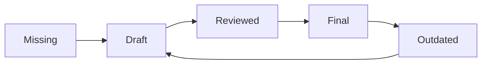

# Localization string table

_How to use this template: italic lines are guidance. Replace them with your own words, then delete them. Values in square brackets are yours to fill in. The table itself is the CSV file next to this page._

## The files

- [Strings](Strings.csv): the table itself, one row per string, one column per language
- [Glossary](01%20Glossary.md): the words translated the same way everywhere, and the names never translated
- [Style guide](02%20Style%20guide.md): how the game speaks in each language

## Columns

| Column | What it holds |
| --- | --- |
| key | A unique name for the string, never shown to players |
| context | Where the text appears and who says it: what a translator cannot guess |
| max_length | The most characters the text may take on screen |
| en | The source text |
| fr, de, es, pl | One column per language, named with its code |

## Naming keys

_Name keys by where the text lives, from the general to the particular, so related strings sort together._

- Pattern: [screen].[element].[detail], such as menu.play or hud.tide.warning
- Lowercase, with dots between the parts and no spaces
- Never reuse a key for a different text: add a new one

## Placeholders and markup

_Values the game fills in stay in braces, such as {count}; every translation keeps every placeholder of its source. Markup tags, such as the bold tag in item.crystal.desc, stay around the words they mark._

## Translation states

_A translation’s state: a changed source makes it outdated, to be checked again_

_Example (Saltmarrow, a sample game): Two cells of the sample are wrong on purpose. menu.settings in German, Einstellungen, has 13 characters where the button holds 10, so the length check flags it; the Archivist’s greeting has no Polish yet, so it counts as missing._

_This template is free to use, change and share. It comes from_ [Nodary](https://nodary.ai)_, where these files import as a map of linked documents and the CSV as a sheet._
