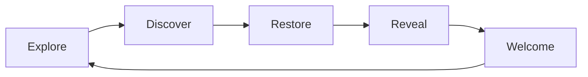

# Gameplay

_What the player does from one minute to the next, and why they keep doing it. Start with the loop: everything else in this document hangs from it._

## Core Loop

_Describe the primary gameplay loop: the sequence of activities the player most commonly repeats. Use a diagram to show how the activities connect, and a beat table to explain what happens during each part. Some games have multiple loops or no single dominant loop; document the structure that best represents the intended experience._

_Typical duration of a cycle: [n minutes, if applicable]_

| Beat      | Typical time | Player's decision or focus                   |
| --------- | ------------ | -------------------------------------------- |
| [Plan]    | [2 min]      | [Which goal this time, and what do I bring?] |
| [Explore] | [...]        | [...]                                        |
| [Collect] | [...]        | [...]                                        |

_Example (Bramblewick, a sample game): Restore a forgotten home, 20 to 30 minutes: clear the overgrowth, repair the structure, and uncover what remains of its former occupants. Do you restore the house as it was, or adapt it to welcome someone new?_

## Mechanics

_List the mechanics that define the gameplay experience. Explain what the player does and, where relevant, which design pillars the mechanic supports. Use this section to evaluate whether mechanics contribute meaningfully to the intended experience._

| Mechanic   | What the player does | Design Pillar supported | Status                                   |
| ---------- | -------------------- | ----------------------- | ---------------------------------------- |
| [Mechanic] | [...]                | [...]                   | [Idea, Prototyped, Validated, Finalized] |
| [Mechanic] | [...]                | [...]                   | [...]                                    |

## Controls

_Describe the player's primary actions and how each should feel to perform. Focus on responsiveness, feedback, precision, and intended player experience rather than specific button mappings. Device-specific controls and accessibility options belong in [[GDD-09 - Interface & Accessibility]]._

- [Verb]: [how it is performed, and how it should feel]
- [Verb]: [...]

## Progression

_Describe how the player, their capabilities, resources, environment, or circumstances change over time. Explain what develops during a typical session, what changes across multiple sessions, and what larger goals or outcomes give the experience direction._

- Within a session: [...]
- Across sessions: [...]
- Long-term goals or outcomes: [...]

## Challenge & Failure

_Describe how the game challenges the player, what happens when they struggle or fail, and how they continue playing. Consider whether difficulty changes over time, what consequences exist, and whether the game provides ways to recover or try again. If the game has no meaningful failure state, explain how it handles setbacks or obstacles instead._

- Challenge increases through: [...]
- Failure or setbacks cost: [...]
- Recovery and continuation: [...]

_Example (Bramblewick, a sample game): A sudden storm catches the player gathering materials in the forest. Unprotected supplies are damaged, and the day's restoration work must wait until the weather clears. Nothing is permanently lost, but the player must decide how to spend the remaining time._

## Development Notes

_Record unresolved questions, additional design considerations, and ideas for future development. Remove questions once they have been answered or document the resulting decisions in the relevant section._

- [ ] [Question, consideration, or idea]

Related: [[GDD-00 - Game Overview]] · [[GDD-02 - Systems & Mechanics]] · [[GDD-06 - Levels & Environment]]
