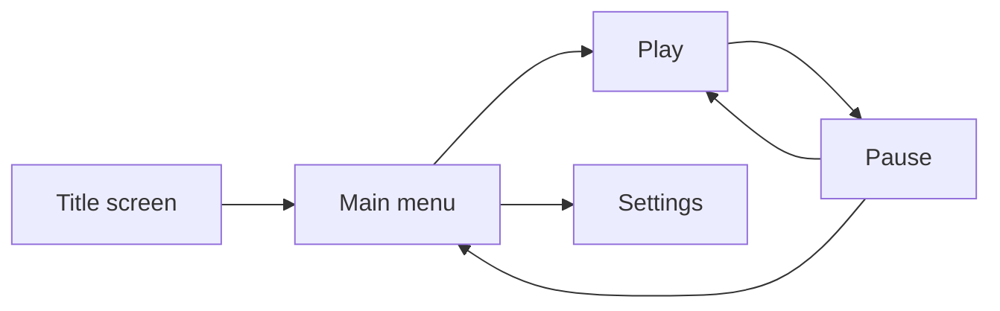

# Interface and accessibility

_Everything the player reads, presses and navigates, and how the game adapts to players who see, hear or move differently._

## Screens and flow

_Document the game's screens, menus, and major interface states, and how the player moves between them. Use a diagram to illustrate navigation, including important transitions, entry points, and ways to return or exit._

_Screen flow_

## HUD & In-Game Interface

_Describe the information and interface elements presented during gameplay, why they are needed, and when they are visible. Consider their importance, context, and how they affect the player's view of and interaction with the game._

| Element | Shows | When it is visible | Priority |
| --- | --- | --- | --- |
| [Health] | [...] | [always, in combat, on request] | [high, medium, low] |
| [Element] | [...] | [...] | [...] |

## Input

_Document the game's input mappings for each supported input device. Identify the inputs used for gameplay, interface navigation, and common actions. Note any configurable bindings or device-specific differences._

| Action | Keyboard and mouse | Controller | Touch |
| --- | --- | --- | --- |
| [Move] | [WASD] | [Left stick] | [...] |
| [Interact] | [E] | [A / Cross] | [...] |
| [Pause] | [Esc] | [Start / Options] | [...] |

## Accessibility

_Document the accessibility features and options the game provides to accommodate players with different needs and preferences. Consider visual, auditory, motor, and cognitive accessibility, as well as options that affect difficulty or the pace of play. Identify applicable features, planned support, and deliberate limitations._

- **Visual:** Text scaling, contrast options, color-independent indicators, colorblind-friendly palettes, visual alternatives to audio cues.
- **Auditory:** Subtitles, speaker identification, subtitle customization, visual alternatives to important sounds, separate volume controls.
- **Motor:** Input remapping, hold/toggle alternatives, adjustable input sensitivity, reduced button combinations, alternative control schemes.
- **Cognitive:** Clear instructions, adjustable information density, simplified interfaces, adjustable timers, reduced time pressure.
- **Motion and sensory:** Camera shake reduction, flashing effects reduction, motion blur options, animation controls.
- **Difficulty and pacing:** Difficulty options, adjustable game speed, assistance features, and ways to reduce or remove time-sensitive challenges.

## Text and languages

_Document the languages supported by the game and the conventions or requirements that affect how text is written, displayed, and localized. Consider text expansion, fonts, character support, and the presentation of localized content._

Potential fields:
- Languages at launch
- Planned additional languages
- Text and localization requirements
- Font and character support
- Text expansion and layout considerations

## Development Notes

_Record unresolved questions, additional design considerations, and ideas for future development. Remove questions once they have been answered or document the resulting decisions in the relevant section._

- [ ] [Question, consideration, or idea]

Related: [[GDD-00 - Game Overview]] · [[GDD-01 - Gameplay]] · [[GDD-02 - Systems & Mechanics]] · [[GDD-08 - Art & Audio Direction]] · [[GDD-04 - Story & Narrative]] · [[TDD-00 - Technical Overview]]
