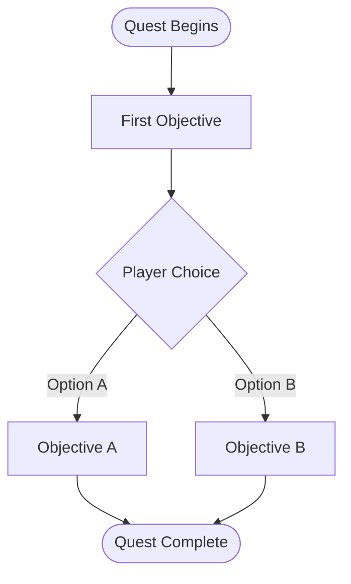

<%*
let title = tp.file.title;
if (title.startsWith("Untitled")) {
	title = await tp.system.prompt("QST-XX - Quest Name");
	if (title) {
		await tp.file.rename(title);
	}
}

// Split at the first " - " into id and name
const separatorIndex = title.indexOf(" - ");
const id = separatorIndex !== -1 ? title.slice(0, separatorIndex).trim() : title;
const name = separatorIndex !== -1 ? title.slice(separatorIndex + 3).trim() : title;
%>---
id: <% id %>
name: <% name %>
status: Open
last_reviewed: <% tp.file.last_modified_date("YYYY-MM-DD") %>
tags:
  - quest
---
# Quest Name
## Overview

_Summarize the quest, its purpose, and its role in the game. Identify what initiates the quest and what the player is expected to accomplish._

- Brief Summary:
- **Quest Giver:** 
- **Quest Type:** 
- **Repeatable:** 

## Narrative

_Describe the narrative context of the quest, including its premise, relevant background, and the story it communicates to the player._

- **Premise:** 
- **Context:** 
- **Narrative Significance:** 

## Objectives & Progression

*Map the quest's objectives and progression using a flowchart. Show how objectives relate to one another, including prerequisites, optional objectives, branching choices, and alternate outcomes. Keep the diagram as simple as the quest allows.*

## Requirements & Conditions

_Document the conditions that affect quest availability, progression, and completion._

- **Availability:** 
- **Prerequisites:** 
- **Progression Conditions:** 
- **Failure Conditions:** 
- **Abandonment Conditions:** 

## Outcomes

*Describe the consequences of completing the quest, including rewards, changes to the world, effects on characters or other quests, and any persistent consequences of player choices.*

- Success outcomes
- Failure outcomes, where applicable
- Consequences for the world, characters, other quests, or future gameplay

## Rewards

_Document the rewards granted for completing the quest and any conditions that affect their availability._

| Reward   | Quantity   | Conditions  |
| -------- | ---------- | ----------- |
| [Reward] | [Quantity] | [Condition] |

## Characters & Locations

*Identify the characters, locations, and other important entities involved in the quest. Link to their respective documents where available.*

- **Characters:** 
- **Locations:** 
- **Other Related Content:** 

## Development Notes

_Record unresolved questions, additional design considerations, and ideas for future development. Remove questions once they have been answered or document the resulting decisions in the relevant section._

- [ ] [Question, consideration, or idea]

Related: [[GDD-04 - Story & Narrative]] · [[GDD-03 - World & Setting]] · [[GDD-05 - Characters]] · [[GDD-07 - Items & Equipment]] · [[SYS-12 - Loot & Rewards]]
